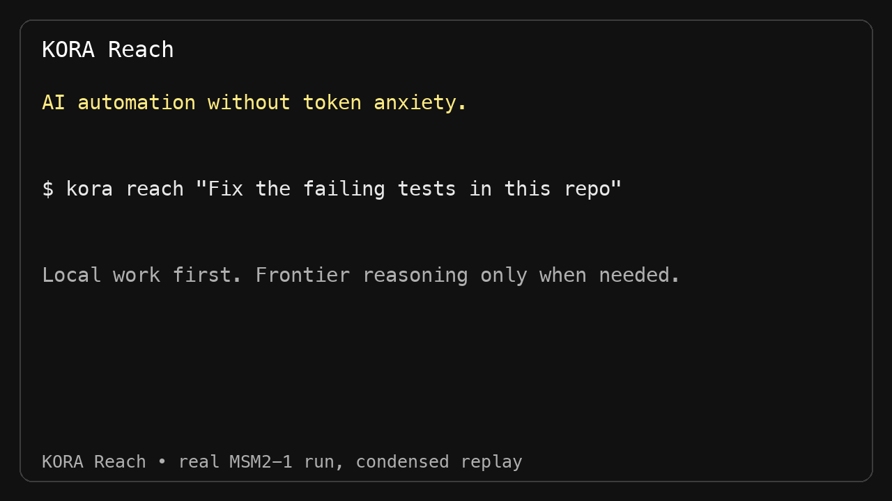

<p align="center">
  
</p>

<p align="center"><strong>Use the AI Plan and Computers You Already Have.</strong></p>

<p align="center">Connect your computers, automate everyday work, and use frontier AI when it matters.</p>

<p align="center">
  
  
  
  
  
</p>

<p align="center">
  <a href="https://github.com/Krako-Labs/kora-reach/releases/tag/v0.2.0"></a>
  
  <a href="LICENSE"></a>
  <a href="https://github.com/Krako-Labs/kora-reach/pull/3"></a>
  
</p>

<br />

**Your existing computers do more of the work.** KORA Reach starts with local commands, tests, file operations, and reusable results. A frontier coding agent is optional for tasks that need reasoning. It verifies outcomes instead of declaring success after a tool call.

**KORA Core** provides the local-first routing principles for Reach. The complete KORA Core runtime and automatic multi-device scheduling are still under development. **AI plan usage limits are not removed or bypassed.**

**Release boundary:** [v0.2.0](https://github.com/Krako-Labs/kora-reach/releases/tag/v0.2.0) includes the stable **CLI** and source for an **experimental authenticated Mac-control MCP node**, including limited Persistent Goals. Mac control requires separate setup and permissions; it is **not** a fully autonomous or production-certified desktop agent.

## Contents

- [Quick start](#quick-start) — run locally before configuring any model
- [Real demo and execution evidence](#real-demo-and-execution-evidence) — see what one completed task actually measured
- [Three tasks to try](#three-tasks-to-try) — coding, file organization, bounded repair
- [How Reach works](#how-reach-works) — architecture image, KORA Core direction, and actual release scope
- [ChatGPT and Mac control](#chatgpt-and-mac-control) — setup, preview features, and access boundaries
- [Safety and limitations](#safety-and-limitations) — permissions, provider limits, and unverified claims
- [Contributing](#contributing) — help turn routine inference into verified local execution
- [Technical reference](#technical-reference) — detailed setup, implementation, and release notes

<br />

## Quick start

Requires **Node.js 22.12+** and Git. No API key or model download is needed for the doctor and local-only path.

**1. Install the published CLI.**

```bash
npm install -g https://github.com/Krako-Labs/kora-reach.git
```

**2. Check your environment.**

```bash
kora doctor
```

**3. Run a local-only task in a project that already has tests.**

```bash
cd /path/to/your-project
kora reach "Fix the failing tests in this repo" --frontier none
```

Reach detects and runs the project's tests. If they fail, local-only mode reports the failure instead of silently calling a model.

<details>
<summary><strong>Optional: enable coding repair with Codex</strong></summary>

Install the separately provided [official Codex CLI](https://github.com/openai/codex) and complete its supported ChatGPT sign-in:

```bash
npm install -g @openai/codex
codex
```

Then, in a repository where you allow source edits:

```bash
kora reach "Fix the failing tests in this repo"
```

This uses applicable Codex/ChatGPT plan allowances and limits. It is **not** an unlimited subscription-to-API gateway.

</details>

<br />

## Real demo and execution evidence



*A condensed recording of one actual end-to-end coding task on MSM2-1, not a benchmark of typical savings.*

```text
Task completed ✓

Total KORA actions             6
Local operations               2
Deterministic routing          3
Cached / reused                0
Frontier escalations           1

83% handled without frontier-model escalation
```

**What this proves:** Reach completed that task and independently reran the tests. An *escalation* is a handoff to an AI coding agent, **not** a count of underlying model API requests or tokens. The 83% figure describes this recorded task only; it is not a general cost or performance guarantee.

<br />

## Three tasks to try

| Task | Command | What Reach does |
|---|---|---|
| **Fix failing tests** | `kora reach "Fix the failing tests in this repo"` | Run tests locally, use optional Codex when necessary, verify again |
| **Organize a folder** | `kora reach "Organize this folder and identify duplicates"` | Group top-level files and report hashes/duplicates locally |
| **Bounded repair loop** | `kora reach "Keep working until the tests pass" --max-rounds 3` | Repeat test → optional repair → verification, with a fixed limit |

Run file organization on a **disposable copy** first. It may move files into category folders, but does not delete duplicates. It refuses organization moves inside Git repositories. Supported test detection includes npm, pnpm, bun, pytest, Cargo, and Go.

<br />

## How Reach works


*Architecture overview of the released CLI and the authenticated Mac-control development preview. The complete KORA Core integration and automatic cross-device orchestration are not yet released.*

**KORA Reach executes. KORA Core guides what should run locally and when model reasoning is worth using.**

| Part | What it does |
|---|---|
| **Your request** | Start from the CLI or an authenticated ChatGPT MCP connection |
| **Reach Node** | Check permissions, select an approved Mac, and run local commands or computer tools |
| **KORA Core principles** | Prefer deterministic execution, reuse valid results, and use frontier reasoning selectively |
| **Local execution** | Work with files, repositories, browser tabs, and approved macOS interfaces |
| **Verification** | Check tests and file outputs; keep bounded job evidence and, in the PR preview, durable Goal status |

Each Mac maintains its own Reach Node and access rules. **Connecting several Macs is not the same as automatic distributed scheduling.** The latter remains in development.

Execution statistics show **local operations, deterministic routes, reused work, and frontier-agent handoffs**. A handoff is not a raw provider API-call count.

<br />

## ChatGPT and Mac control

The [MCP preview on `main`](docs/CHATGPT_FIRST_MCP.md) connects ChatGPT to a **user-owned Mac** through an authenticated Reach Node. It offers files, commands, browser and native Mac tools, plus a local Reach Console. The experimental live-screen viewer depends on the connected ChatGPT host.

For Mac setup and permission boundaries, follow [Phase A installation](docs/PHASE_A_INSTALL.md):

```bash
git clone --branch main https://github.com/Krako-Labs/kora-reach.git
cd kora-reach
node scripts/setup-mac.mjs
```

The installer creates a restricted local service. It does **not** expose your Mac to the internet or silently approve macOS Accessibility or Screen Recording. ChatGPT connection requires a properly authenticated HTTPS MCP endpoint or a supported secure tunnel.

### Persistent Goals — source preview

The **v0.2.0 source preview** includes experimental computer-control and durable local Goal capabilities:

- Bind an **already authorized** detached local job to a Goal ID.
- Query its status from a new authenticated session after a Node restart.
- Independently check an expected file SHA-256 and store a write-once historical verification receipt.
- Optionally continue **evidence observation** after chat disconnect, without restarting an uncertain action.

**Not yet supported as a general product claim:** arbitrary multi-step autonomous planning, automatic Chrome-account migration, unrestricted macOS GUI operation, or guaranteed Reach selection in every ChatGPT conversation.

These capabilities have passed local and isolated-Mac tests, but are not a certified production Mac-control deployment. See [verified control QC and open gates](docs/VERIFIED_CONTROL_QC.md).

<br />

## Safety and limitations

- **Explicit scope:** local commands and file access follow the configured workspace policy. An approved tool is not permission to bypass another tool's access restriction.
- **Computer control:** macOS Accessibility, Screen Recording, website sign-in, and an unlocked GUI session may still require user action. Safe background work can continue while GUI tasks wait.
- **Side effects:** uncertain clicks, downloads, and submissions must be reconciled before retrying. Duplicate files are reported, not deleted.
- **Models:** optional Codex is installed separately. An AI subscription does not imply unlimited frontier requests or override provider usage limits, policies, or licensing.
- **Verification:** passing unit tests or a local GUI fixture does not establish production readiness, deployment parity, or real-user completion rates.
- **Privacy:** CLI execution is local-first. Connecting a Mac through MCP introduces a separate authenticated remote-control surface that you must configure and secure.

KORA Reach is **not** a hosted SaaS, a generic subscription proxy, or a promise of unlimited model usage.

<br />

## Contributing

**The best contributions remove avoidable model work without reducing correctness or safety.** Useful additions include deterministic handlers, reproducible access failures, browser/profile compatibility tests, and verifiable completion criteria.

- [Report an issue or contribute a failing scenario](https://github.com/Krako-Labs/kora-reach/issues)
- [Read the contribution guide](CONTRIBUTING.md)
- [Read Mac-control setup](docs/CHATGPT_FIRST_MCP.md)

[**KORA Doctor**](https://github.com/Krako-Labs/kora-doctor) diagnoses possible inference waste in execution traces. **KORA Reach** avoids unnecessary inference during execution. Both are independent open-source projects.

**License:** [Apache-2.0](LICENSE) for the core CLI. The separate MCP Node package is MIT-licensed; optional tools have their own licenses. **Maintained by:** [Krako Labs](https://github.com/Krako-Labs).

<br />

## Technical reference

- [Mac MCP architecture and setup](docs/CHATGPT_FIRST_MCP.md)
- [Local Mac installation](docs/PHASE_A_INSTALL.md)
- [Verified control and GUI QC evidence](docs/VERIFIED_CONTROL_QC.md)
- [Safe update staging and limitations](docs/P1_SAFE_NODE_UPDATE.md)
- [Research and provider access boundaries](docs/RESEARCH.md)
- [Release notes for v0.2.0](docs/RELEASE_NOTES_v0.2.0.md)

The core CLI has no runtime npm dependencies. To run development checks:

```bash
npm run check
cd apps/reach-node
npm ci
npm run check:ci
```
